# Praxis

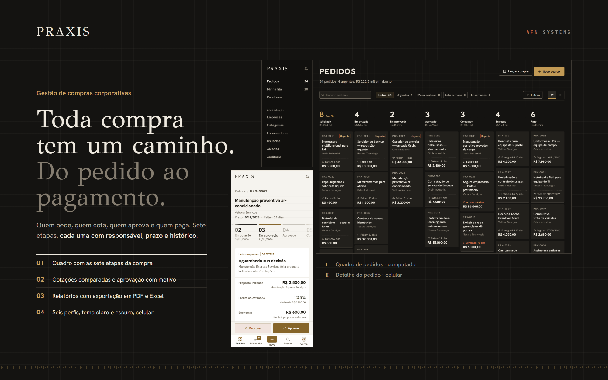

Praxis runs the purchasing of a group of companies, from request to payment.
Someone opens a request, a buyer gathers supplier quotes, an approver decides,
the purchase is made, delivery is confirmed and finance pays the installments.
Every step has an owner, a deadline and a history, and each role sees only what
belongs to it.

**Live demo:** [praxis-af618.web.app](https://praxis-af618.web.app). On the sign-in screen, click **Acessar modo demo** (open demo mode). The product presentation (in Portuguese) is at [/apresentacao.html](https://praxis-af618.web.app/apresentacao.html).

[](https://github.com/alyssom-fernandes/Praxis/actions/workflows/testes.yml)


This README is also available in [Portuguese](README.pt-br.md). The app speaks Brazilian Portuguese and English: switch on the sign-in screen or in Settings.

**Case study:** [how it was built and why, with links to the code](https://alyssom-fernandes.github.io/portfolio/en/projetos/praxis/) on my portfolio.

**Contents:** [In 30 seconds](#in-30-seconds) · [Screens](#screens) · [In motion](#in-motion) · [Features](#features) · [Quality, measured](#quality-measured) · [How an order moves](#how-an-order-moves) · [Technical decisions](#technical-decisions) · [Running it](#running-it) · [Structure](#structure)

## In 30 seconds

1. Open the [demo](https://praxis-af618.web.app) and click **Acessar modo demo**.
   Choose who you want to be: one person per role (administrator, manager, approver, buyer, finance or
   requester), each seeing and doing only what their role allows. You can switch at any time from the bar
   at the top. There are three fictitious companies, with 34 orders spread across every stage.
2. On the board, open **PRX-0003** (awaiting approval): compare the three quotes and approve, or reject with a reason.
3. Switch to **Eduardo Lima** (finance) and open the bell: **PRX-0012** (purchased, paid upfront) has an overdue installment. Open it and record the payment.
4. In **Relatórios** (reports), change the period and export to PDF or Excel, or print it.
5. Switch roles (for example, to the requester or the approver) and see the same operation through the eyes of whoever owns each step.
6. Play around freely: the demo data resets every day.

## Screens

Captured from the demo.

| Request board, dark theme | Order detail, light theme |
|---|---|
| 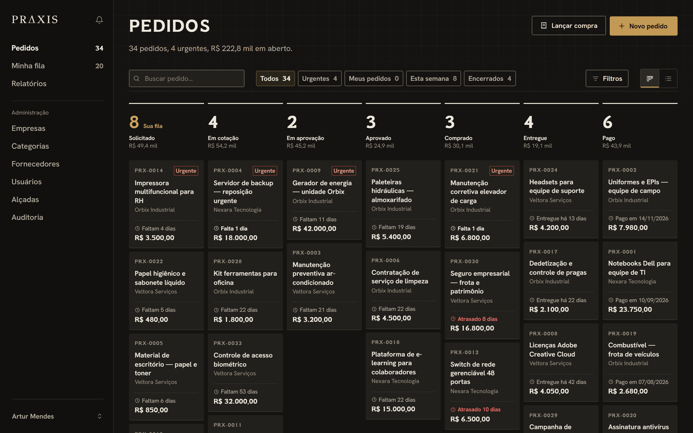 | 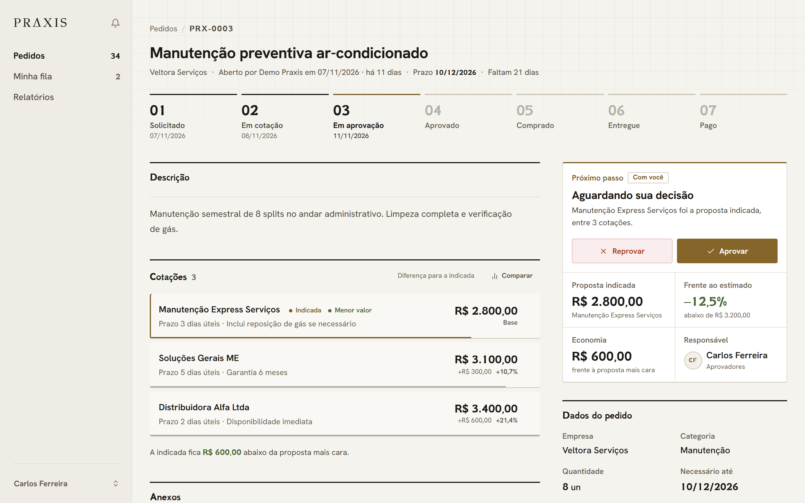 |
| **Reports, light theme** | **Users and roles, dark theme** |
| 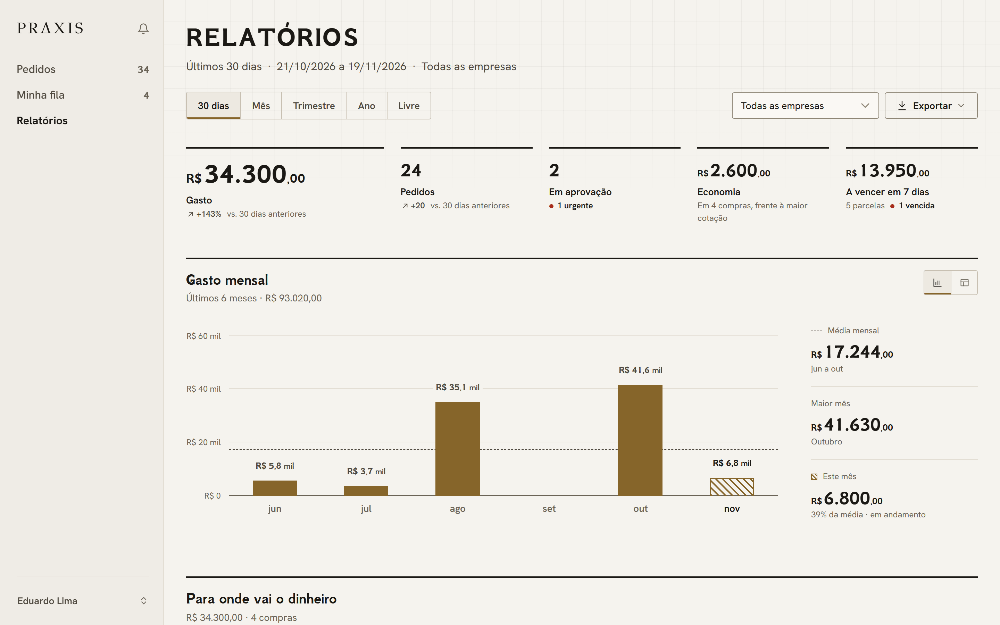 | 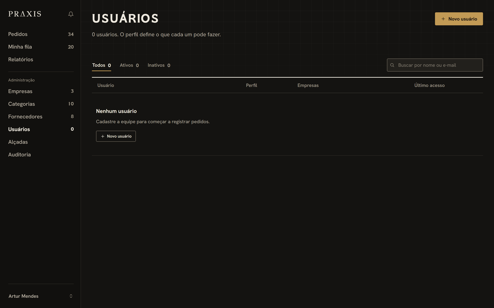 |
| **Sign-in** | **The order as a PDF** |
|  | 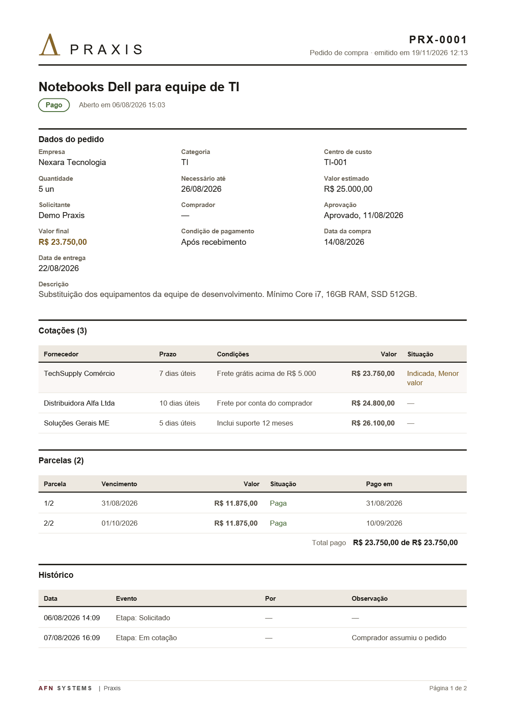 |

| On a phone, light theme | On a phone, dark theme |
|---|---|
| 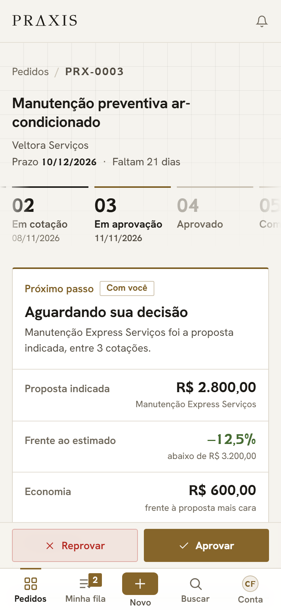 | 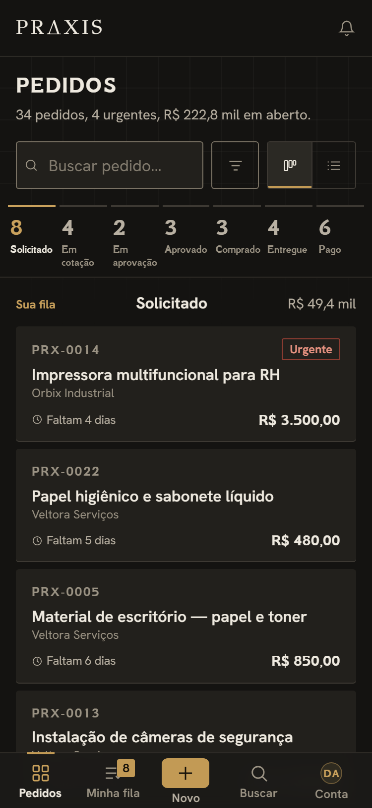 |

| On a tablet, lying down: the order in two columns, the decision at hand |
|---|
| 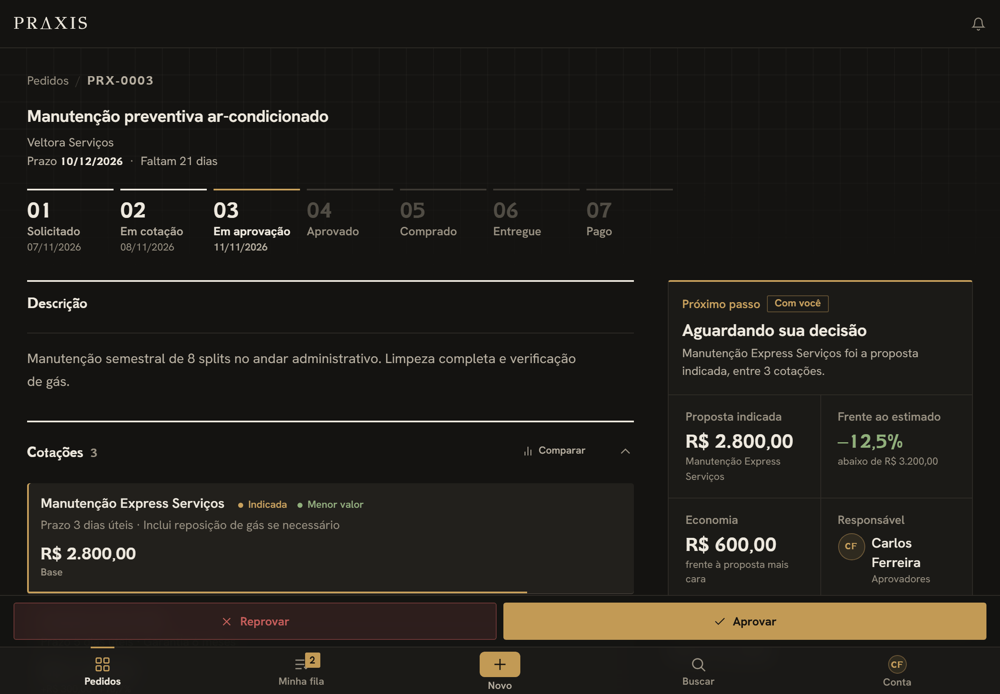 |

## In motion

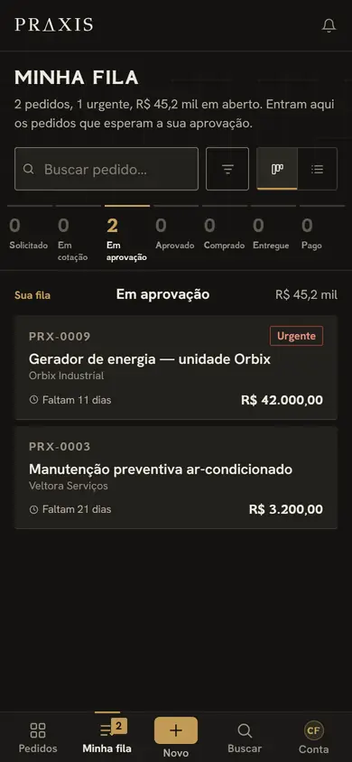

On a phone, from the approver's queue: the card title travels into the order header, and approving ends with the bronze seal (8 seconds, with the animations slowed down so each step shows). Moving between Orders, My queue and Reports slides the content in the direction you are going, and the report bars rise when the page opens. With reduced motion turned on, all of it is instant.

---

## Features

**The flow**

- **Board and list.** The seven stages side by side, a total per column and a deadline on every card; drag and drop follows each role. The list adds filters, sorting, saved views and bulk actions.
- **Quotes.** Several proposals per order, compared side by side with the difference to the lowest, and a supplier registry that never duplicates names, with CSV import.
- **Approval with a trail.** Approve, or reject with a reason; a rejected order can be reopened with a justification. Approval tiers by value set how many people approve, and who.
- **Purchase, delivery and installments.** Supplier, final amount and installments; each installment is paid with its receipt, and the last one closes the order.
- **Purchase already made.** For what was bought outside Praxis: what, where, how much, the invoice (typed or read from its QR code), who authorized it and why. If it has arrived and is paid, it is recorded in one step.
- **Several items per order.** Up to 30 items with quantity, unit and unit price, a discount in R$ or %, and the vehicle (old or Mercosur plate, as one record) with the mileage. While typing, the history suggests the unit, last price, supplier and category.
- **Requisition without quotes.** For the usual supplier, when the company turns it on (with an amount limit): the order goes straight to approval, the authorization comes out as a PDF to show at the counter, and whoever picked it up records the pickup. The company can also let the approver who opened an order approve it up to an amount, logged in the history.
- **Supplier invoice.** When the company turns it on, finance pays at once the delivered purchases from the same supplier.
- **Buy again and "Usually runs out".** Finished orders repeat with one tap, and the buyer's queue flags the item that usually runs out, from the typical interval of past purchases.

**Control**

- **Six roles, enforced on the server.** Each stage moves only by the role that owns it, and whoever opens or quotes an order cannot approve it. Matrix in [`docs/permissoes.md`](docs/permissoes.md).
- **Several companies.** Each person works only with the companies they belong to; the top role sees all of them.
- **Access without e-mail.** For staff without e-mail, the manager creates a username and a first password, and the person picks their own on first sign-in.
- **Audit and a copy of the data.** Administrative changes are logged with who and when, and a manager downloads everything from their companies as JSON, with counts to check against.

**Reports**

- Spend, orders, savings from quotes and installments due, against the previous period; charts by month, stage, category and company; process time per step, with the bottleneck; PDF, Excel and a print layout. Approvers see operational data only.

**Experience**

- **The next step is always visible.** Each order says who acts next and what is missing.
- **Phone, tablet and desktop.** On a phone, a bottom bar with "+", 44 px touch targets and the Android back button closing the open window. Requesters open on "My orders". A tablet lying down shows the order in two columns, as on a desktop.
- **Installable and offline.** The whole app version stays on the device: it opens without network, and a new version only takes over when the person taps "Update". An order opened offline is kept on the device and goes out by itself when the connection returns.
- **Search and a WhatsApp nudge.** Search finds by number, item, supplier and plate; an order waiting on someone has "Notify on WhatsApp" with the message and link ready.
- **Motion with a purpose, keyboard and palette.** The transitions above, a command palette (Ctrl+K) and one-key shortcuts, a guided tour, light and dark themes, and Portuguese and English.
- **Comments with @mentions, attachments and the full history** in one timeline, and in-app notifications in real time (the automatic ones come from Cloud Functions, with e-mail once an API key is set).
- **Demo mode** with fictitious data whose dates follow today's date, rebuilt every day.

## Quality, measured

Every number below was measured, with the date and the command that repeats it. The phone measurements simulate Lighthouse's "slow 4G" (150 ms, 1.6 Mbit/s) and a 4x slower CPU, and take the median of three runs.

| What | Result | Measured | Command |
|---|---|---|---|
| Lighthouse on the live site: performance, accessibility, best practices, SEO | 98 · 100 · 100 · 100 | Nov 19, 2026 | `URL=https://praxis-af618.web.app/ RODADAS=3 npm run lighthouse` |
| Sign-in screen painted, first visit, on a phone | 1.4 s | Nov 19, 2026 | `npm run medir-desempenho` |
| Reopening the app, up to the board | 2.4 s | Nov 19, 2026 | `npm run medir-desempenho` |
| Opening with no connection, up to the board | 0.4 s | Nov 19, 2026 | `npm run medir-desempenho` |
| Every role's main screens at 390 and 360 px: sideways scroll, 44 px targets, 16 px fields, contrast and axe-core (WCAG 2.2 AA rules) | no failure | Nov 19, 2026 | `npm run testar-e2e` |
| Security rules, on the emulator | 69 tests pass | Nov 19, 2026 | `npm run testar-regras` |
| Unit tests: text in both languages, contrast and focus, installable app, notices | 85 tests pass | Nov 19, 2026 | `npm run testar-unidade` |

GitHub Actions runs the tests, the type check and Lighthouse (90 minimum in all four scores) on every push.

## How an order moves

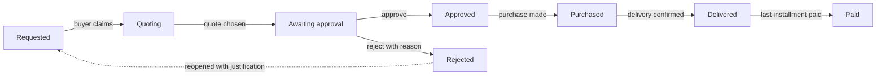

An order can be cancelled with a reason: by its requester while it waits for a buyer, and by a manager until delivery. It only goes to approval with a chosen quote, and from then on its quotes no longer change. Whoever opened or quoted an order cannot approve or reject it, and quotes and delivery belong to the buyer who claimed it. The rules for each transition are in [`docs/fluxo-pedidos.md`](docs/fluxo-pedidos.md), and the name of each stage and interface term in [`docs/glossario.md`](docs/glossario.md) (Portuguese, with the English terms).

## Technical decisions

- **No framework and no build step.** The browser loads ES Modules directly; the whole interface comes from a CSS token system with light and dark themes.
- **Security on the server, not in the UI.** Each user's role and companies come from the auth token (custom claims set by a Cloud Function) or, on the free plan without the Function, from the person's own document, which only a manager or the supremo can change. The Firestore and Storage rules check every read and write: who may take each step of an order, which fields that step may change, and which companies each user reaches, files included (the Storage rules look up in Firestore the order each file belongs to). They also require the reason for rejecting or cancelling and the chosen quote before approval. No role skips a step, the top one included: its extra power is administration (people, companies and registries). The rules have automated tests on the emulator (`npm run testar-regras`), run by GitHub Actions on every push.
- **Separation of duties.** Whoever opens or quotes an order cannot approve or reject it, and whoever approves it cannot record the purchase or the payment. The rules enforce it in Firestore and Storage, and the screens run the same check to hide the action and say why. The supremo, the top role kept for the team that develops the system, is exempt from it and from the approval levels.
- **Defense in depth in the browser.** Everything written by users is escaped before it reaches the page, and the site sends a Content Security Policy with no inline scripts, plus anti-framing and no-sniff headers. Fonts and the export libraries (jsPDF and ExcelJS) are served by the site itself, and the Firebase SDK loads with `integrity` hashes that match the npm release the tests use.
- **No races between users.** Claiming an order and approving it use `runTransaction`: if two people click at once, only one wins. Every status change writes its history entry in the same transaction or batch, so an order never moves without a record. Edits, quotes, attachments and receipts do the same, and the rules refuse them without the entry.
- **A demo that never gets stale.** The seed stores the date it was written for and shifts every date to today on each rebuild.
- **The public demo runs on Firebase's free plan.** It has no Cloud Functions: the demo account gets its role from the rules (by e-mail), the daily rebuild runs in the app itself ([`js/demo-reset.js`](js/demo-reset.js)), in the background, so the first visitor of the day sees the board right away, and the notifications in the bell are samples. In the demo, the person you pick changes the screens and the actions offered; the server-side enforcement of each role is proven by the rules tests. Automatic notifications, e-mails and scheduled jobs run in the emulators or on the paid plan. Cloud Storage has also required the paid plan since February 3, 2026 ([Firebase FAQ](https://firebase.google.com/docs/storage/faqs-storage-changes-announced-sept-2024)), so file uploads are turned off in the demo: quotes are recorded without the file, and attachments and receipts show a notice instead.
- **A demo account that cannot reach real data.** Its password ships in the public `js/config.js`, so the rules give it a role of its own, `demo`, that is worth nothing else: it only reads and writes records marked as demo (orders with `demo-…` IDs and `isDemo == true`, the demo people, companies, categories and suppliers) and files of demo orders. It never touches real users, companies, categories, orders or files, and a real order can never be turned into a demo one.
- **Everything verifiable locally.** With the Firebase emulators the whole app runs on your machine without touching real data.

More in [`docs/arquitetura.md`](docs/arquitetura.md), and the reasoning behind each choice in [`docs/decisoes.md`](docs/decisoes.md) (Portuguese).

## Running it

### Locally, with the emulators (no Firebase account needed)

Requirements: Node.js 24.12+ and Java 21+ (for the Firestore emulator).

> **On Windows,** if the Firestore emulator stops right after starting, point Java's temporary folders to a folder of your own before running it, for example `set JAVA_TOOL_OPTIONS=-Djava.io.tmpdir=C:\tmp -Djdk.net.unixdomain.tmpdir=C:\tmp` (it happened with JDK 21, with the default user temp folder).

```bash
npm install
cd functions && npm install && cd ..
cp js/config.example.js js/config.js   # the sample values already work with the emulators
npm run emuladores                     # keep it running
```

In another terminal:

```bash
npm run seed      # 34 orders, 3 companies and one account per role
npm run servir    # the app is served at http://localhost:8123
```

To run the security rules tests (they start and stop their own emulators):

```bash
npm run testar-regras
```

The unit tests need no emulator. They cover the interface text check (every key in both languages, no text outside the dictionary), color contrast in both themes (text at 4.5:1; focus ring and field border at 3:1, per WCAG) with a single focus style across the CSS, and the Cloud Functions' notification rules (who gets each notice, one notice per event, dates in São Paulo time):

```bash
npm run testar-unidade
```

The end-to-end test opens the app in a headless browser (Playwright) against the emulators with the seed data, and takes one request from opening to approval, each step signed in with its own role (requester, buyer, approver). In the same command, `tests/celular.test.mjs` goes through the main screens of each role at 390 and 360 px (no sideways scroll, 44 px touch targets, an accessible name on every control, 16 px fields, AA contrast and no console errors) and opens the app offline, through the service worker and the local cache. The first time, download the browser:

```bash
npx playwright install chromium
```

```bash
npm run testar-e2e
```

Performance is measured on a simulated phone (390 × 844, Lighthouse "slow 4G" and a 4x slower CPU) against the emulators: first visit to the sign-in screen, sign-in to the board, reopening the app to the board and opening it offline, as the median of three runs:

```bash
npm run medir-desempenho
```

And Lighthouse on the sign-in screen, served as Firebase Hosting serves it (CI requires 90 in all four scores):

```bash
npm run lighthouse
```

Type checking (TypeScript, no build) covers the app's rule modules: `npm run tipos`.

On `localhost` the app connects to the emulators by itself. Use **Acessar modo demo**, or sign in as
`supremo@`, `gestor@`, `aprovador@`, `comprador@`, `financeiro@` or `solicitante@praxis.app`, all with the
password `demo1234`, to see the system through each role.

### On your own Firebase project

1. Create a project with Firestore, Authentication (email and password), Storage and Cloud Functions.
2. Fill `js/config.js` with the project keys and update `.firebaserc`.
3. `npx firebase deploy`. The rules (`firestore.rules`, `storage.rules`) and indexes are in the repository. The Storage rules read the role from Firestore; on the first deploy, Firebase asks you to allow that access.
4. In Authentication › Settings › User actions, keep account creation on (the default): invited people create their own password in the app. The rules only accept an invitation from an account whose email was confirmed through the link Firebase sends.
5. Create the first supremo by hand: the sign-in account in Authentication and, in Firestore, the document `usuarios/{account UID}` with `nome`, `email`, `perfil: "supremo"`, `empresas: []` and `ativo: true`.
6. From then on, people join by invitation: in Settings › Users, an administrator invites by email. On the sign-in screen, the person taps **Primeiro acesso? Criar senha** (First time here? Create password), uses the invited email and confirms it through the link Firebase sends; on the next sign-in, the person gets the role from the invitation. An account created by hand in Authentication also works once its email is confirmed (the app sends the link on the first sign-in).

> **Do not create the demo account (`demo@praxis.app`) in a project with real data.** Its password goes into `js/config.js`, which the site serves to every visitor. The rules keep it away from real data, but anyone with it could still create and change demo records. The demo account belongs only in a project made for the public demo.

## Structure

```
index.html            single entry point, with the sign-in screen already written in (scripts/gerar-entrada.mjs)
css/                  tokens → base → components → views (sign-in) → telas (app screens) → themes
js/
  entrada.js          entry point: the sign-in screen shows without waiting for Firebase
  app.js              session, routes (?tela=), sidebar, navigation, card ↔ order transition
  estado.js           the session and the hooks modules share, with no window globals
  constants.js        stages, roles, t() and idioma()
  textos-pt.js        interface text in Portuguese (ships with the app)
  textos-en.js        English text (downloaded only when English is chosen)
  pedidos*.js         board and list, "My orders", filters, saved views, bulk actions
  pedido-detalhe.js   the order page; detalhe-*.js: decision, actions, comments, attachments
  itens*.js           order items (discount, plate, suggestions, search, "Usually runs out")
  novo-pedido.js      items, vehicle, cost center and requisition in the order form
  requisicao.js       requisition: PDF authorization and invoice math; detalhe-requisicao.js, the pickup
  fatura.js           the supplier invoice; acesso.js and senha-nova.js, access without e-mail
  relatorios*.js      dashboard, charts and exports
  ui.js, tour.js      shared components (notices, dialogs, decision seal) and the tour
  config-*.js         users, registries and preferences
  demo-*.js           demo people and the daily rebuild
functions/            triggers, scheduled jobs and the demo seed
vendor/               jsPDF and ExcelJS, copied unchanged from npm, with their licenses
scripts/              emulator seed, service worker list and CSP (gerar-sw), static sign-in (gerar-entrada),
                      performance (medir-desempenho) and Lighthouse
tests/                rules (emulator), unit, interface text, installable app, Functions notices,
                      end-to-end and phone (390 and 360 px, axe-core, production CSP, offline)
docs/                 architecture, decisions, order flow, glossary and permissions (in Portuguese)
```

## License

MIT. See [`LICENSE`](LICENSE). To report a security problem, see [`SECURITY.md`](SECURITY.md).

---

**AFN SYSTEMS** · by Alyssom Fernandes
