# Praxis

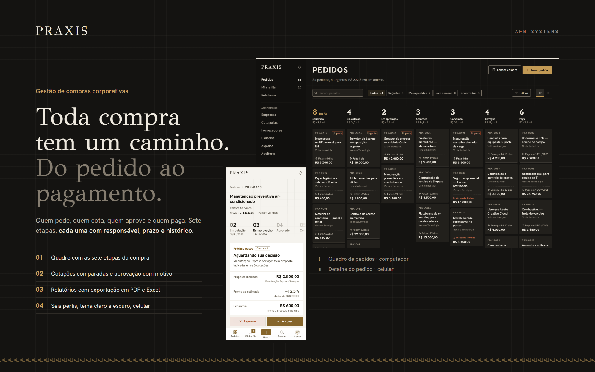

O Praxis organiza as compras de um grupo de empresas, do pedido ao pagamento.
Alguém abre uma solicitação, o comprador reúne as cotações, o aprovador decide,
a compra é feita, a entrega é confirmada e o financeiro paga as parcelas. Cada
etapa tem responsável, prazo e histórico, e cada perfil vê só o que lhe cabe.

**Demonstração ao vivo:** [praxis-af618.web.app](https://praxis-af618.web.app). Na entrada, clique em **Acessar modo demo**.

[](https://github.com/alyssom-fernandes/Praxis/actions/workflows/testes.yml)


Este README também está em [inglês](README.md). O app fala português e inglês: a troca fica na entrada e em Ajustes.

**Estudo de caso:** [como foi construído e por quê, com links para o código](https://alyssom-fernandes.github.io/portfolio/projetos/praxis/) no meu portfólio.

**Neste README:** [Em 30 segundos](#em-30-segundos) · [Telas](#telas) · [Em movimento](#em-movimento) · [Funcionalidades](#funcionalidades) · [Qualidade, medida](#qualidade-medida) · [Como um pedido anda](#como-um-pedido-anda) · [Decisões técnicas](#decisões-técnicas) · [Como rodar](#como-rodar) · [Estrutura](#estrutura)

## Em 30 segundos

1. Abra a [demonstração](https://praxis-af618.web.app) e clique em **Acessar modo demo**.
   Escolha quem você quer ser: uma pessoa por perfil (administrador, gestora, aprovador, compradora,
   financeiro ou solicitante), cada uma vendo e fazendo só o que o perfil dela permite. Dá para trocar
   a qualquer momento pela faixa no topo. São três empresas fictícias, com 34 pedidos em todas as etapas.
2. No quadro, abra o **PRX-0003** (em aprovação): compare as três cotações e aprove ou reprove com motivo.
3. Troque para o **Eduardo Lima** (financeiro) e abra o sino: o **PRX-0012** (comprado, pagamento antecipado) tem uma parcela vencida. Abra o pedido e registre o pagamento.
4. Em **Relatórios**, troque o período e exporte em PDF ou Excel, ou mande imprimir.
5. Troque de perfil (por exemplo, para a solicitante ou o aprovador) e veja a mesma operação pelos olhos de quem está em cada etapa.
6. Mexa à vontade: os dados de demonstração voltam ao original todo dia.

## Telas

Capturadas do modo demonstração.

| Quadro de pedidos, tema escuro | Detalhe do pedido, tema claro |
|---|---|
| 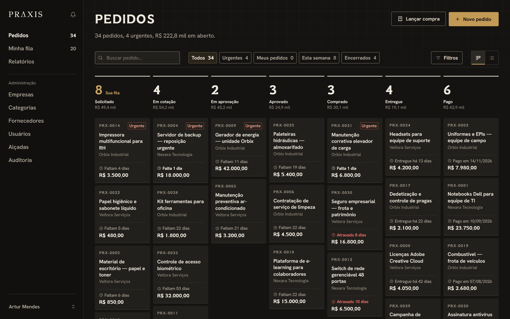 | 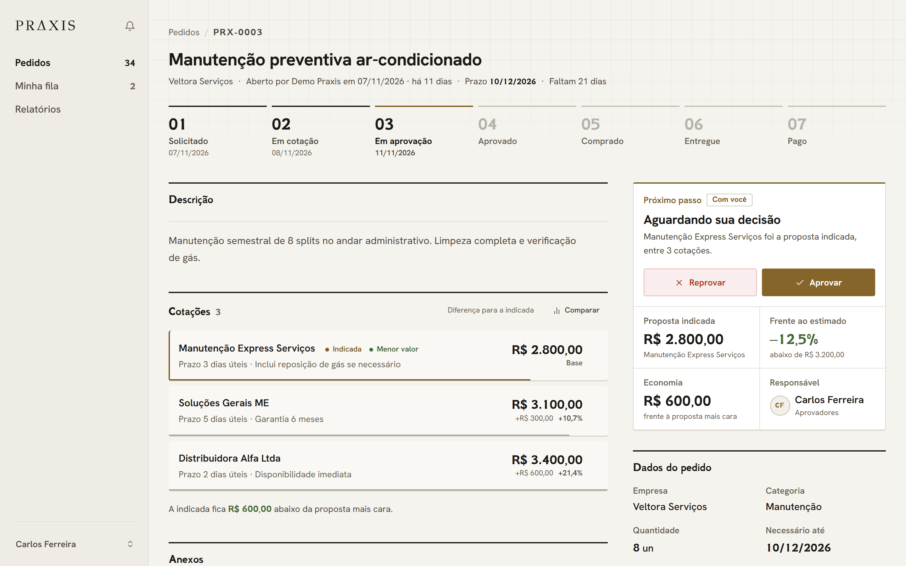 |
| **Relatórios, tema claro** | **Usuários e perfis, tema escuro** |
| 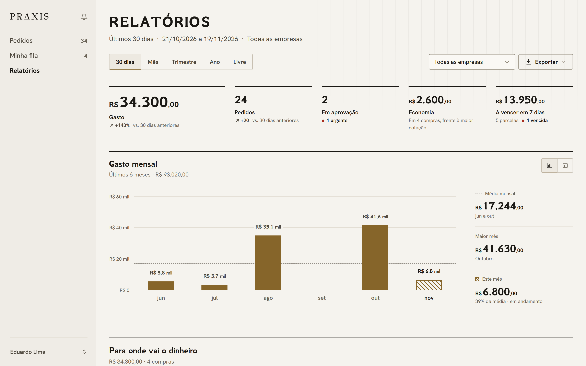 | 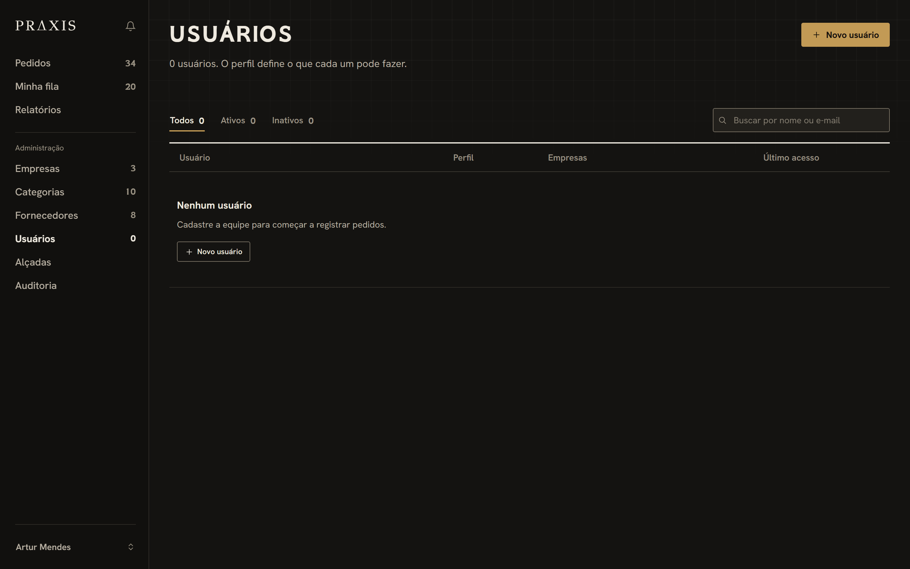 |
| **Entrada** | **O pedido em PDF** |
|  | 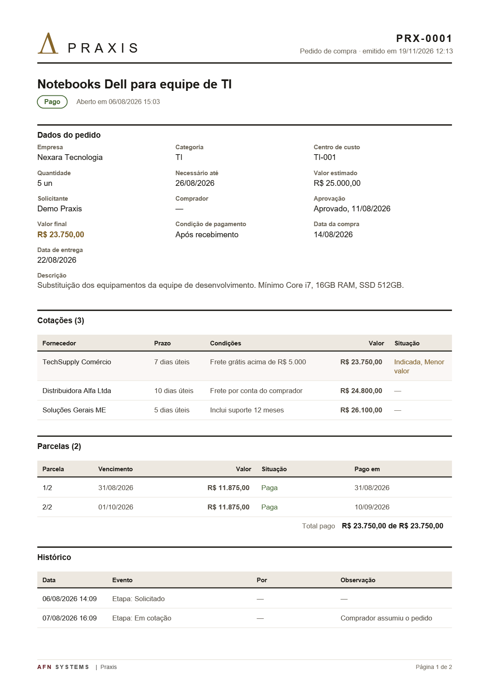 |

| No celular, tema claro | No celular, tema escuro |
|---|---|
| 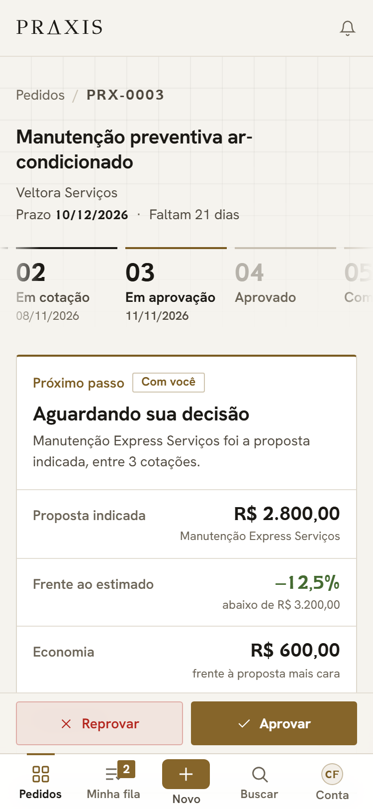 | 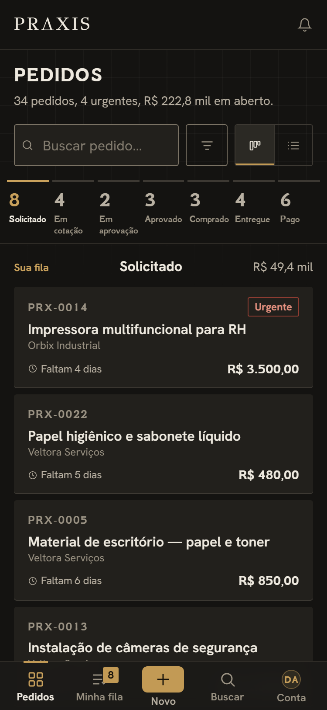 |

| No tablet deitado: o pedido em duas colunas, a decisão à mão |
|---|
| 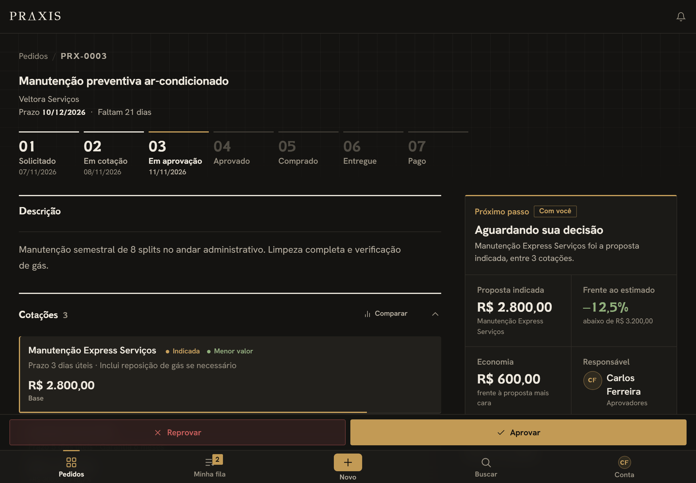 |

## Em movimento

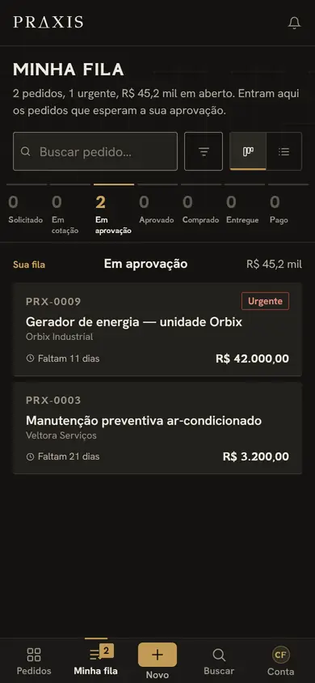

No celular, a partir da fila do aprovador: o título do cartão vira o título do pedido, e aprovar termina com o selo de bronze (8 segundos, com as animações desaceleradas para cada passo aparecer). Entre Pedidos, Minha fila e Relatórios, o conteúdo desliza no sentido da navegação, e as barras dos relatórios sobem quando a página abre. Com o movimento reduzido ligado, tudo é instantâneo.

---

## Funcionalidades

**O fluxo**

- **Quadro e lista.** As sete etapas lado a lado, a soma de cada coluna e o prazo em cada cartão; o arrastar segue o perfil de cada um. A lista tem filtros, ordenação, visões salvas e ações em massa.
- **Cotações.** Várias propostas por pedido, comparadas lado a lado com a diferença para a menor, e um cadastro de fornecedores que nunca duplica nomes, com importação por CSV.
- **Aprovação rastreável.** Aprovar, ou reprovar com motivo; o pedido reprovado pode ser reaberto com justificativa. As alçadas por valor definem quantas pessoas aprovam, e quem.
- **Compra, entrega e parcelas.** Fornecedor, valor final e parcelas; cada parcela é paga com o comprovante, e a última encerra o pedido.
- **Compra já feita.** Para o que foi comprado fora do Praxis: o quê, onde, quanto, a nota fiscal (digitada ou lida pelo QR), quem autorizou e por quê.

**Controle**

- **Seis perfis, garantidos no servidor.** Cada etapa só anda pelo perfil dono dela, e quem abre ou cota um pedido não pode aprová-lo. Matriz em [`docs/permissoes.md`](docs/permissoes.md).
- **Várias empresas.** Cada pessoa trabalha só com as empresas a que pertence; o perfil supremo vê todas.
- **Auditoria e cópia dos dados.** As mudanças administrativas ficam registradas com quem e quando, e o gestor baixa tudo das empresas dele em JSON, com as contagens para conferir.

**Relatórios**

- Gasto, pedidos, economia nas cotações e parcelas a vencer, frente ao período anterior; gráficos por mês, etapa, categoria e empresa; tempo do processo por etapa, com o gargalo; PDF, Excel e versão para imprimir. O aprovador vê só os dados operacionais.

**Experiência**

- **O próximo passo sempre à vista.** Cada pedido diz quem age agora e o que falta.
- **Celular, tablet e computador.** No celular, a barra de baixo com o "+", toques de 44 px e o voltar do Android fechando a janela aberta. Quem só pede abre em "Meus pedidos". O tablet deitado mostra o pedido em duas colunas, como no computador.
- **Instalável e sem internet.** A versão inteira do app fica no aparelho: ele abre sem rede, e a versão nova só entra quando a pessoa toca em "Atualizar".
- **Movimento com função, teclado e paleta.** As transições acima, a paleta de comandos (Ctrl+K) e atalhos de uma tecla, o tour guiado, os temas claro e escuro, e português e inglês.
- **Comentários com @menções, anexos e o histórico completo** numa linha do tempo só, e avisos no app em tempo real (os automáticos vêm das Cloud Functions, com e-mail quando há chave de API).
- **Modo demonstração** com dados fictícios cujas datas acompanham o dia de hoje, refeitos todo dia.

## Qualidade, medida

Cada número abaixo foi medido, com a data e o comando que o repete. As medidas no celular simulam o "4G lento" do Lighthouse (150 ms, 1,6 Mbit/s) e um processador 4 vezes mais lento, e usam a mediana de três rodadas.

| O quê | Resultado | Medido em | Comando |
|---|---|---|---|
| Lighthouse no site no ar: desempenho, acessibilidade, boas práticas, SEO | 99 · 100 · 100 · 100 | 19/11/2026 | `URL=https://praxis-af618.web.app/ RODADAS=3 npm run lighthouse` |
| Entrada pintada, primeira visita, no celular | 1,4 s | 19/11/2026 | `npm run medir-desempenho` |
| Reabrir o app, até o quadro | 2,4 s | 19/11/2026 | `npm run medir-desempenho` |
| Abrir sem internet, até o quadro | 0,4 s | 19/11/2026 | `npm run medir-desempenho` |
| Telas principais de cada perfil a 390 e 360 px: rolagem lateral, toques de 44 px, campos de 16 px, contraste e axe-core (regras da WCAG 2.2 AA) | nenhuma falha | 19/11/2026 | `npm run testar-e2e` |
| Regras de segurança, no emulador | 69 testes passam | 19/11/2026 | `npm run testar-regras` |
| Testes de unidade: textos nas duas línguas, contraste e foco, app instalável, avisos | 85 testes passam | 19/11/2026 | `npm run testar-unidade` |

O GitHub Actions roda os testes, a checagem de tipos e o Lighthouse (mínimo de 90 nas quatro notas) a cada push.

## Como um pedido anda

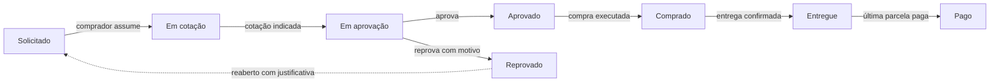

O pedido pode ser cancelado com motivo: pelo solicitante enquanto espera um comprador, e pelo gestor até a entrega. Ele só vai para aprovação com uma cotação indicada, e dali em diante as cotações não mudam mais. Quem abriu ou cotou o pedido não o aprova nem o reprova, e as cotações e o recebimento ficam com o comprador que assumiu. As regras de cada transição estão em [`docs/fluxo-pedidos.md`](docs/fluxo-pedidos.md), e o nome de cada etapa e de cada termo da interface, em [`docs/glossario.md`](docs/glossario.md).

## Decisões técnicas

- **Sem framework e sem etapa de build.** O navegador carrega os ES Modules direto; a interface inteira sai de um sistema de *tokens* em CSS, com tema claro e escuro.
- **Segurança no servidor, não na tela.** O perfil e as empresas de cada usuário vêm do token (*custom claims*, definidos por uma Cloud Function) ou, no plano gratuito, sem a Function, do documento da própria pessoa, que só um gestor ou o supremo altera. As regras do Firestore e do Storage conferem cada leitura e escrita: quem pode dar cada passo do pedido, que campos aquele passo pode mudar e a que empresas cada usuário chega, inclusive nos arquivos (as regras do Storage conferem no Firestore o pedido de cada arquivo). Elas também exigem o motivo da reprovação e do cancelamento e a cotação indicada antes da aprovação. Nenhum perfil pula etapa, nem o supremo: o poder a mais dele é a administração (pessoas, empresas e cadastros). As regras têm testes automáticos no emulador (`npm run testar-regras`), rodados pelo GitHub Actions a cada envio.
- **Separação de funções.** Quem abre ou cota um pedido não o aprova nem reprova, e quem o aprova não registra a compra nem o pagamento. As regras impõem isso no Firestore e no Storage, e as telas fazem a mesma conferência para esconder a ação e dizer por quê. O supremo, perfil máximo reservado à equipe que desenvolve o sistema, fica livre dessa trava e da alçada.
- **Defesa em camadas no navegador.** Tudo o que os usuários escrevem é escapado antes de chegar à página, e o site envia uma política de segurança de conteúdo (CSP) sem scripts inline, mais cabeçalhos contra enquadramento e *sniffing*. As fontes e as bibliotecas de exportação (jsPDF e ExcelJS) são servidas pelo próprio site, e o SDK do Firebase carrega com `integrity`, conferido com a versão do npm que os testes usam.
- **Sem corrida entre usuários.** Assumir um pedido e aprovar usam `runTransaction`: se duas pessoas clicam juntas, só uma vence. Toda mudança de status grava a entrada do histórico na mesma transação ou no mesmo lote, então o pedido nunca anda sem deixar registro. Edições, cotações, anexos e comprovantes fazem o mesmo, e as regras os recusam sem a entrada.
- **Demonstração que não envelhece.** O seed guarda a data para a qual foi escrito e desloca todas as datas até o dia de hoje a cada recriação.
- **A demonstração pública roda no plano gratuito do Firebase.** Não tem Cloud Functions: a conta demo recebe o perfil pelas regras (pelo e-mail), a recriação diária roda no próprio app ([`js/demo-reset.js`](js/demo-reset.js)), em segundo plano, para o primeiro visitante do dia ver o quadro na hora, e os avisos do sino são de exemplo. Na demonstração, a pessoa escolhida muda a tela e as ações oferecidas; a imposição de cada perfil no servidor fica provada pelos testes das regras. Notificações automáticas, e-mails e rotinas agendadas rodam nos emuladores ou no plano pago. O Cloud Storage também exige o plano pago desde 03/02/2026 ([FAQ do Firebase](https://firebase.google.com/docs/storage/faqs-storage-changes-announced-sept-2024)), então o envio de arquivos fica desligado na demonstração: a cotação é registrada sem o arquivo, e anexos e comprovantes mostram um aviso no lugar.
- **Uma conta demo que não alcança dados reais.** A senha dela vai no `js/config.js` público, então as regras dão a ela um perfil próprio, `demo`, que não vale como nenhum outro: só lê e grava registros marcados como demo (pedidos com ID `demo-…` e `isDemo == true`, as pessoas, empresas, categorias e fornecedores da demonstração) e arquivos de pedidos da demo. Ela nunca toca em usuários, empresas, categorias, pedidos ou arquivos reais, e nenhum pedido real vira pedido da demo.
- **Tudo verificável localmente.** Com os emuladores do Firebase, o app roda inteiro na máquina, sem tocar em dados reais.

Mais detalhes em [`docs/arquitetura.md`](docs/arquitetura.md), e o porquê de cada escolha em [`docs/decisoes.md`](docs/decisoes.md).

## Como rodar

### Localmente, com os emuladores (sem conta no Firebase)

Requisitos: Node.js 24.12 ou superior e Java 21 ou superior (para o emulador do Firestore).

> **No Windows,** se o emulador do Firestore parar logo depois de abrir, aponte as pastas temporárias do Java para uma pasta sua antes de rodar, por exemplo `set JAVA_TOOL_OPTIONS=-Djava.io.tmpdir=C:\tmp -Djdk.net.unixdomain.tmpdir=C:\tmp` (aconteceu com o JDK 21, na pasta temporária padrão do usuário).

```bash
npm install
cd functions && npm install && cd ..
cp js/config.example.js js/config.js   # os valores de exemplo já servem para os emuladores
npm run emuladores                     # deixe rodando
```

Em outro terminal:

```bash
npm run seed      # 34 pedidos, 3 empresas e uma conta por perfil
npm run servir    # o app fica em http://localhost:8123
```

Para rodar os testes das regras de segurança (eles sobem e derrubam os próprios emuladores):

```bash
npm run testar-regras
```

Os testes de unidade não precisam de emulador. Eles cobrem a lista do service worker (`npm run gerar-sw` depois de mudar js/, css/, index.html, fontes ou ícones; o teste falha enquanto ela estiver velha), o manifest e as versões dos CSS, a conferência dos textos da interface (toda chave nos dois idiomas, nenhum texto fora do dicionário), o contraste das cores nos dois temas (texto a 4,5:1; anel de foco e borda de campo a 3:1, pelo WCAG) com um só estilo de foco nos CSS, e as regras dos avisos das Cloud Functions (quem recebe cada aviso, um aviso por evento, datas no horário de São Paulo):

```bash
npm run testar-unidade
```

O teste de ponta a ponta abre o app num navegador sem janela (Playwright), contra os emuladores com os dados do seed, e leva um pedido da abertura à aprovação, cada passo com o seu perfil (solicitante, comprador e aprovador). No mesmo comando, `tests/celular.test.mjs` passa pelas telas principais de cada perfil a 390 e a 360 px (sem rolagem lateral, toques de 44 px, nome acessível em todo controle, campos de 16 px, contraste AA e nenhum erro de console) e abre o app sem internet, pelo service worker e pela cópia local. Na primeira vez, baixe o navegador:

```bash
npx playwright install chromium
```

```bash
npm run testar-e2e
```

O desempenho é medido num celular simulado (390 × 844, "4G lento" do Lighthouse e CPU 4 vezes mais lenta), contra os emuladores: primeira visita até a entrada, entrar até o quadro, reabrir o app até o quadro e abrir sem internet, com a mediana de três rodadas:

```bash
npm run medir-desempenho
```

E o Lighthouse na entrada, servida como no Firebase Hosting (o CI exige 90 nas quatro notas):

```bash
npm run lighthouse
```

A checagem de tipos (TypeScript, sem compilar) cobre as regras do app: `npm run tipos`.

Em `localhost` o app se conecta sozinho aos emuladores. Na entrada, use **Acessar modo demo**
ou entre com `supremo@`, `gestor@`, `aprovador@`, `comprador@`, `financeiro@` ou `solicitante@praxis.app`,
todos com a senha `demo1234`, para ver o sistema por cada perfil.

### No seu projeto Firebase

1. Crie um projeto com Firestore, Authentication (e-mail e senha), Storage e Cloud Functions.
2. Preencha `js/config.js` com as chaves do projeto e ajuste `.firebaserc`.
3. `npx firebase deploy`. As regras (`firestore.rules`, `storage.rules`) e os índices estão no repositório. As regras do Storage leem o perfil no Firestore; na primeira publicação, o Firebase pede para liberar esse acesso.
4. Em Authentication › Configurações › Ações do usuário, deixe a criação de contas ligada (o padrão): quem foi convidado cria a própria senha no app. As regras só aceitam o convite de uma conta com o e-mail confirmado pelo link que o Firebase envia.
5. Crie o primeiro supremo à mão: a conta de login no Authentication e, no Firestore, o documento `usuarios/{UID da conta}` com `nome`, `email`, `perfil: "supremo"`, `empresas: []` e `ativo: true`.
6. Daí em diante, as pessoas entram por convite: em Configurações › Usuários, quem administra convida pelo e-mail. Na entrada, a pessoa toca em **Primeiro acesso? Criar senha**, usa o e-mail do convite e o confirma pelo link que o Firebase envia; ao entrar de novo, recebe o perfil do convite. Uma conta criada à mão no Authentication também serve, depois de confirmado o e-mail (o app envia o link no primeiro acesso).

> **Não crie a conta demo (`demo@praxis.app`) num projeto com dados reais.** A senha dela vai no `js/config.js`, que o site entrega a todo visitante. As regras a mantêm longe dos dados reais, mas quem tiver a senha ainda consegue criar e alterar registros da demo. A conta demo só cabe num projeto feito para a demonstração pública.

## Estrutura

```
index.html            entrada única, com a tela de entrada já escrita (scripts/gerar-entrada.mjs)
css/                  tokens → base → componentes → views (entrada) → telas (do app) → temas
js/
  entrada.js          ponto de entrada: a entrada aparece sem esperar o Firebase
  app.js              sessão, rotas (?tela=), barra lateral, navegação, cartão ↔ pedido
  estado.js           a sessão e os ganchos que os módulos compartilham, sem globais na janela
  constants.js        etapas, perfis, t() e idioma()
  textos-pt.js        textos da interface em português (vem com o app)
  textos-en.js        textos em inglês (baixados só por quem escolhe o inglês)
  pedidos*.js         quadro e lista, "Meus pedidos", filtros, visões salvas, ações em massa
  pedido-detalhe.js   o detalhe do pedido; detalhe-*.js: decisão, ações, comentários, anexos
  relatorios*.js      painel, gráficos e exportações
  ui.js, tour.js      componentes comuns (avisos, janelas, selo da decisão) e o tour
  config-*.js         usuários, cadastros e preferências
  demo-*.js           pessoas da demonstração e a recriação diária
functions/            gatilhos, rotinas agendadas e o seed da demonstração
vendor/               jsPDF e ExcelJS, copiados do npm sem alteração, com as licenças
scripts/              seed dos emuladores, lista do service worker e CSP (gerar-sw), entrada estática
                      (gerar-entrada), desempenho (medir-desempenho) e Lighthouse
service-worker.js     a versão do app guardada no aparelho (lista gerada por scripts/gerar-sw.mjs)
tests/                regras (emulador), unidade, textos, app instalável, avisos das Functions, ponta a ponta
                      e celular (390 e 360 px, axe-core, CSP da produção, sem internet)
docs/                 arquitetura, decisões, fluxo de pedidos, glossário e permissões
```

## Licença

MIT. Veja [`LICENSE`](LICENSE). Para avisar um problema de segurança, veja o [`SECURITY.md`](SECURITY.md).

---

**AFN SYSTEMS** · por Alyssom Fernandes
